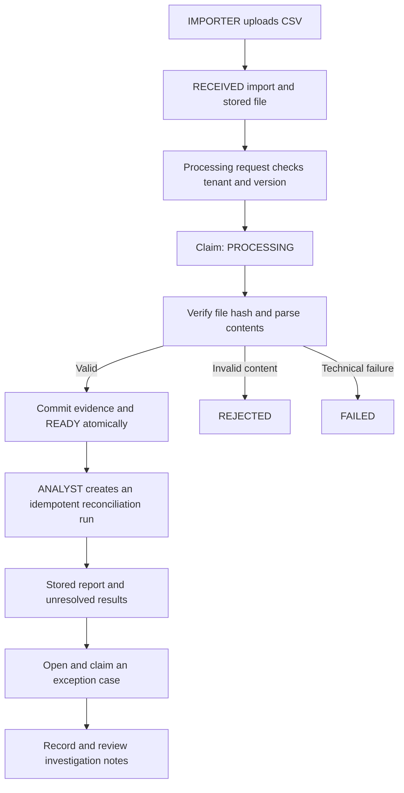
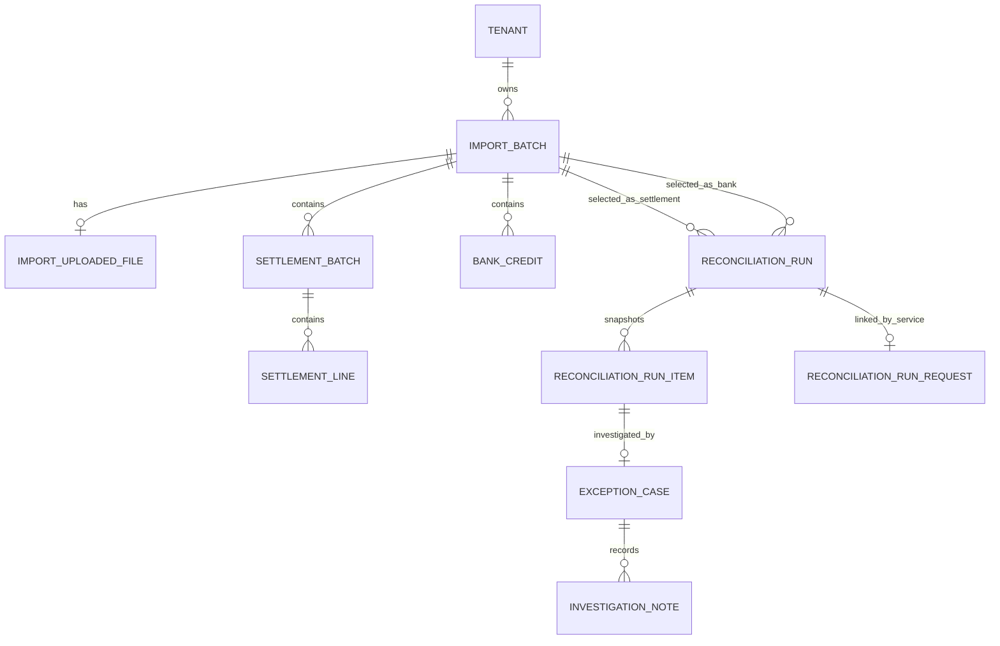

# ReconBridge

**Settlement Reconciliation & Exception Management**

ReconBridge is a Java 21 and Spring Boot backend portfolio project that reconciles processor settlement batches against bank credits and supports tenant-isolated exception investigation. It demonstrates secure REST APIs, transactional persistence, idempotency, concurrency control, SQL pagination, and strategy-based matching.

The domain layer also supports internal-payment-to-settlement matching and combined two-pass reports. Persistent internal-payment ingestion is still planned; the current stored-run API reconciles settlement and bank imports.

**Current scope:** CSV upload and processing, persisted reconciliation runs, run history and unresolved-result queries, exception-case opening and claiming, investigation notes, and paginated case and note queries. Resolution proposals and independent approval are next.

## Contents

- [Problem statement](#problem-statement)
- [Implementation status](#implementation-status)
- [Technology stack](#technology-stack)
- [Architecture and processing flow](#architecture-and-processing-flow)
- [Implemented capabilities](#implemented-capabilities)
- [Design patterns and data structures](#design-patterns-and-data-structures)
- [API reference](#api-reference)
- [Postman workflow](#postman-workflow)
- [CSV contracts](#csv-contracts)
- [Persistence model](#persistence-model)
- [Local configuration](#local-configuration)
- [PowerShell command reference](#powershell-command-reference)
- [Testing and verification](#testing-and-verification)
- [Current limitations](#current-limitations)
- [Roadmap](#roadmap)
- [Project documentation](#project-documentation)
- [Scope](#scope)

## Problem statement

A successful payment does not prove that the expected settlement reached the bank. Fees, missing records, duplicate references, delayed credits, currency differences, and incorrect amounts can produce discrepancies between systems.

ReconBridge compares payment evidence with processor settlement lines, then compares settlement batch totals with bank credits. Matching reports explain discrepancies and preserve ambiguous candidates. Exception cases let analysts claim discrepancies and record investigation notes. Resolution proposals, independent approval, and a complete decision audit trail are planned.

### Example

| Item | Amount |
| --- | ---: |
| Successful payments | INR 3,000 |
| Processor fees | INR 60 |
| Expected bank credit | INR 2,940 |
| Actual bank credit | INR 2,900 |
| Shortfall to investigate | INR 40 |

## Implementation status

| Area | Status |
| --- | --- |
| Monetary values, matching keys, and matching strategies | Implemented |
| Payment-to-settlement matching and combined two-pass reports | Implemented as domain logic |
| Settlement and bank CSV upload, parsing, and persistence | Implemented |
| Stored-file ownership checks, SHA-256 verification, and synchronous processing | Implemented |
| Import lifecycle and optimistic concurrency control | Implemented |
| Keycloak JWT authentication, RBAC, and tenant isolation | Implemented |
| Settlement evidence queries and bank reconciliation preview | Implemented |
| Atomic saved reconciliation runs and request idempotency | Implemented |
| Paginated run history and unresolved-result queries | Implemented |
| Exception-case opening, retrieval, claiming, and investigation notes | Implemented |
| Paginated case listing, assignment/status filters, and note history | Added in the latest milestone; confirm with the local test suite |
| Resolution proposals and independent approval | Next milestone |
| Persisted internal-payment ingestion and stored three-source reconciliation | Planned |
| Automatic recovery, transactional outbox, Kafka, and Kubernetes | Planned |

Uploading creates a `RECEIVED` import. Processing is a separate API call; upload does not automatically parse or reconcile a file. `rowCount` remains zero until processing completes successfully.

## Technology stack

| Technology | Current use |
| --- | --- |
| Java 21 | Records, collections, streams, monetary calculations, file I/O, SHA-256 |
| Spring Boot 4.1.1 / Spring MVC | REST APIs, multipart handling, application configuration |
| Spring Security OAuth2 Resource Server / Keycloak | JWT validation, realm-role mapping, tenant identity |
| Jakarta Bean Validation | API request validation |
| Spring Data JPA / Hibernate | Tenant and import mappings, optimistic version checks |
| Spring JDBC / JdbcTemplate | Evidence and report persistence, JDBC batching, and paginated read queries |
| MySQL / Flyway | Relational integrity and versioned schema migrations |
| Apache Commons CSV 1.14.1 | Settlement and bank statement CSV parsing |
| Spring Boot Actuator | Health endpoint |
| JUnit / AssertJ / Mockito / MockMvc | Unit and integration testing |
| Maven Wrapper / Git / Postman | Build, version control, and manual API verification |

Kafka, transactional outbox delivery, Docker/Testcontainers, and Kubernetes are roadmap items. Spring Batch remains a possible future option, not an implemented dependency.

## Architecture and processing flow

The HTTP layer validates requests and enforces roles. Application services establish tenant-scoped transaction boundaries, domain objects enforce business rules, and repositories persist evidence and snapshots.



Failure transitions are attempted only while the worker still owns the expected import version. A stale worker must not overwrite newer state. File reading and parsing occur outside the short database transactions used for claiming and completion.

## Implemented capabilities

### Reconciliation domain

- Immutable `Money` values use integer minor units, currency validation, and overflow-checked arithmetic.
- Tenant-aware and provider-aware `MatchKey` values identify payment matches.
- `SettlementKey` adds bank-account and settlement references for bank matching.
- Strategy-based matching reports `MATCHED`, `MISSING_COUNTERPART`, `AMBIGUOUS`, `AMOUNT_MISMATCH`, and `CURRENCY_MISMATCH`.
- Candidate indexes preserve repeated references instead of silently choosing one match.
- Settlement lines validate gross, fee, and net amounts; batches validate their declared total against line net amounts.
- Reports identify orphan settlement lines and orphan bank credits, with separate outcome counts for both passes.
- Bank comparisons include signed differences when currencies match.
- Combined reconciliation uses the same settlement evidence for both passes and requires both passes and orphan checks to succeed.
- Domain safeguards reject duplicate IDs, duplicate internal payment keys, and settlement-line reuse across supplied batches.

### Authentication, authorization, and tenant isolation

- Validates JWT issuer, timestamps, audience, and tenant claim.
- Uses an administrator-controlled `tenant_id` claim rather than caller-supplied tenant values.
- Explicitly maps `IMPORTER`, `ANALYST`, `APPROVER`, and `AUDITOR` realm roles.
- Uses stateless security and denies endpoints unless explicitly permitted.
- Returns the authenticated subject and tenant from `GET /api/me`.
- Looks up imports using both tenant ID and import ID; absent and foreign-tenant imports return `404`.
- Requires `IMPORTER` for registration and upload. An `AUDITOR`-only token can read permitted resources but cannot create imports.

### Registration and file upload

- Accepts JSON metadata registration or multipart CSV upload at `POST /api/imports`.
- Generates import IDs and initializes status `RECEIVED`, row count zero, and the initial persistence version.
- Returns `201 Created` with a `Location` header.
- Enforces uniqueness on `(tenant_id, source_type, source_system, file_hash)` through MySQL, including competing registrations.
- Returns `409` for duplicate content; separate tenants may register identical content independently.
- Multipart upload computes SHA-256 from actual streamed bytes, generates storage filenames, and stores opaque `local:<uuid>.csv` references.
- Enforces size and filename rules, removes partial writes where cleanup succeeds, and removes a newly stored duplicate while preserving the original.
- Rejects unprovisioned tenants and validates metadata fields.

JSON registration validates the supplied hash's format but does not verify file contents or fetch its supplied URI. Multipart upload generates the hash and storage reference on the server. A `.csv` extension alone does not establish that the file is valid CSV.

### Import lifecycle and concurrency

- Guarded transitions support `RECEIVED -> PROCESSING -> READY`, with `REJECTED` for invalid content and `FAILED` for operational failure.
- An explicit `FAILED -> PROCESSING` retry transition exists in the lifecycle service.
- `READY` and `REJECTED` are terminal in the current model.
- Application services enforce expected-version checks alongside JPA `@Version` optimistic locking.
- Service responses are immutable snapshots containing the persisted version.
- Integration tests verify that stale workers cannot overwrite committed state.

### Processor settlement CSV validation

- Requires the documented header order and validates UTF-8, with optional byte-order mark support.
- Supports quoted CSV fields, including references containing commas.
- Validates canonical UUIDs, supported currency codes, integer minor-unit amounts, line arithmetic, and batch totals.
- Rejects duplicate settlement line IDs across the file and inconsistent batch metadata.
- Preserves repeated payment references so reconciliation can classify them as ambiguous.
- Derives tenant and provider from trusted import context; neither is accepted as a CSV column.
- Enforces a default maximum of 100,000 data records.
- Reports content errors as `CsvValidationException`; technical read failures remain `IOException`.

### Bank statement CSV parsing

Implemented a bank-credit CSV parser using Apache Commons CSV.

The parser:
- Receives tenant identity from trusted application code.
- Validates headers, UUIDs, required fields, positive minor-unit amounts,
  currency codes, and UTF-8 encoding.
- Rejects duplicate credit IDs within a file.
- Preserves distinct credits sharing a settlement key so reconciliation
  can detect ambiguous matches.
- Limits input to 10 MiB and 100,000 data records.
- Returns an immutable list of validated BankCredit objects.

Parser unit tests cover valid input, duplicate IDs, invalid values,
encoding, quoted fields, malformed CSV, and file-size validation.

### Atomic settlement persistence

- Uses tenant- and import-scoped composite keys and foreign keys for settlement evidence.
- Validates tenant ownership, source type, provider, `PROCESSING` status, expected version, and supplied batch identities.
- Writes settlement rows using JDBC batches of up to 500 lines.
- Flushes the versioned import update before inserting evidence to protect competing completions.
- Commits batches, lines, row count, version, and the `READY` status together in one transaction.
- Rolls back all new records and import changes if persistence fails.
- Requires an existing transaction at the settlement write repository boundary.

The JDBC batch size does not split the transaction. The rollback integration test deliberately fails a later insert and verifies that earlier inserts and the JPA update are rolled back.

### Bank-credit persistence

Added a Flyway migration for tenant-scoped bank-credit storage.

BankCreditPersistenceService saves credits and transitions a BANK_STATEMENT
import from PROCESSING to READY in one transaction.

Completion validates tenant ownership, source type, lifecycle state,
expected version, and duplicate credit IDs.

The versioned import update is flushed before credit insertion.
A later persistence failure rolls back both the inserted credits and
the READY transition.

Distinct credits with the same settlement matching key are preserved
for ambiguity detection during reconciliation.

Integration tests cover successful completion, stale-version rejection,
tenant isolation, invalid inputs, and rollback after a later insert fails.

### End-to-end settlement import processing

- Added POST /api/imports/{importId}/process, restricted to IMPORTER.
- Verifies tenant ownership and server-recorded file ownership.
- Claims RECEIVED imports using the expected optimistic version.
- Reads the stored file and verifies its SHA-256 hash before parsing.
- Persists settlement batches and lines together with the READY transition.
- Marks invalid CSV as REJECTED and technical failures as FAILED when
  the failure transition can be committed.
- Prevents stale workers from overwriting newer import state.
- Includes integration tests for processing, authorization, integrity
  failures, competing requests, and transaction rollback.

Processing is currently synchronous. Automatic recovery of abandoned
PROCESSING imports, retry endpoints, and persisted error history remain planned.

### Bank statement processing

The existing POST /api/imports/{importId}/process endpoint now dispatches
PROCESSOR_SETTLEMENT and BANK_STATEMENT imports to their respective processors.

Bank processing:
1. Claims a tenant-owned RECEIVED import using its expected version.
2. Requires server-managed uploaded-file ownership.
3. Reads the stored file and verifies its SHA-256 hash.
4. Parses and validates bank-credit CSV records.
5. Persists credits and transitions the import to READY atomically.

Invalid CSV contents result in REJECTED. Storage and persistence failures
result in FAILED when that state transition can be committed.
Stale workers cannot overwrite a newer import version.

Integration tests cover successful processing, invalid CSV, missing and
modified files, replay prevention, tenant isolation, role enforcement,
and overlapping processing requests.

Internal payment processing and automatic retry/recovery remain unimplemented.

### Settlement evidence API

Processed processor settlement imports expose paginated batch and line
read endpoints:

- GET /api/imports/{importId}/settlement-batches
- GET /api/imports/{importId}/settlement-batches/{batchId}/lines

Both endpoints derive tenant identity from the validated JWT and permit
IMPORTER, ANALYST, APPROVER, and AUDITOR roles.

Evidence is available only for PROCESSOR_SETTLEMENT imports in READY status.
Missing imports and imports belonging to another tenant return 404.

Pagination uses zero-based page numbers. The default page size is 20,
with an allowed range of 1–100. Responses include items, page, size,
totalElements, and totalPages.

Service unit tests cover pagination, ownership lookup, source and status
validation, missing batches, and empty pages. HTTP access and database
retrieval are verified separately through Postman.

### Bank reconciliation preview

`GET /api/reconciliation/bank-preview` compares explicitly selected, tenant-owned `READY` settlement and bank imports without saving a run or modifying their status/version. It validates source types and persisted evidence, reports all five matching outcomes, and includes orphan bank credits.

The preview is bounded to protect memory use. It is not an unbounded, background reconciliation job.

### Stored runs and idempotency

- `POST /api/reconciliation/runs` requires `ANALYST` and an `Idempotency-Key` header.
- Each run stores selected import IDs, matching-rule and report-format versions, authenticated creator, UTC creation time, summary counts, and individual result snapshots.
- Run creation and result persistence commit atomically; a failure rolls back both.
- Retrieval reads the saved snapshot without rerunning matching.
- A new key creates a run (`201`). Repeating the same key and request within the tenant returns the original run (`200`).
- Reusing the key with different selected import IDs returns `409`.
- Keys are tenant-scoped. Concurrent requests are coordinated through a database request record and locking.
- Run history is paginated. Unresolved-result queries exclude matches and support filtering by mismatch outcome or orphan bank credits.

### Exception investigation

- An analyst opens a case against an unresolved stored run item: a settlement batch or orphan bank credit.
- Matched results cannot open cases. Reopening the same run item returns its existing case rather than creating a duplicate.
- Opening returns `200` for both a new and an existing case under the current API contract.
- Cases start `OPEN`. Claiming transitions the case to `IN_REVIEW` and records the authenticated analyst as assignee.
- Claims and note additions require the expected case version. Stale versions return `409`.
- Only the assigned analyst may add investigation notes. Note insertion and case-version advancement commit atomically.
- Notes record the authenticated author and creation time; no note update/delete API is exposed.
- Allowed read roles can retrieve cases and notes within their tenant. Foreign-tenant cases return `404`.

### Exception investigation queries

- Paginated case listing supports optional `status` and `assignedToMe` filters.
- `assignedToMe=true` uses the authenticated subject; callers do not supply another user's identity.
- `assignedToMe=false` disables the assignment filter; it does not mean unassigned.
- Cases are ordered by creation time descending, then ID descending.
- Notes are ordered by creation time ascending, then ID ascending.
- Pages are zero-based, default to 20 records, and allow sizes from 1 to 100.
- Responses include `items`, `page`, `size`, `totalElements`, and `totalPages`.
- Reads do not advance the case version. A missing/foreign case returns `404`; an existing case with no notes returns an empty page.

## Design patterns and data structures

| Technique | Where it is used |
| --- | --- |
| Strategy | Interchangeable payment and bank matching contracts |
| Adapter | CSV input converted into validated domain records; storage abstraction |
| Repository | Tenant-scoped evidence, run, and case persistence |
| Application service / transaction boundary | Import completion, run creation, case claims, and note insertion |
| Immutable records | Money, identities, matching results, and service snapshots |
| HashMap | Candidate indexing and settlement-key validation |
| HashSet | Duplicate IDs, reused lines, and orphan detection |
| LinkedHashMap | CSV batch grouping with input-order preservation |
| EnumMap | Outcome counts for reconciliation reports |

Matching and parser passes use expected linear-time indexing/grouping relative to their input sizes. The parser retains parsed records, so its memory use is O(n); upload streams bytes rather than loading the full file into memory.

## API reference

Base URL: `http://localhost:8083`

**Read roles** means any of `IMPORTER`, `ANALYST`, `APPROVER`, or `AUDITOR`. All protected resource operations are tenant-scoped.

| Method | Endpoint | Access / purpose |
| --- | --- | --- |
| GET | `/actuator/health` | Public health check |
| GET | `/api/me` | Read roles; authenticated subject and tenant |
| POST | `/api/imports` | `IMPORTER`; JSON metadata or multipart file upload |
| GET | `/api/imports/{importId}` | Read roles; import details |
| POST | `/api/imports/{importId}/process` | `IMPORTER`; process uploaded settlement or bank evidence |
| GET | `/api/imports/{importId}/settlement-batches` | Read roles; paginated batches |
| GET | `/api/imports/{importId}/settlement-batches/{batchId}/lines` | Read roles; paginated lines |
| GET | `/api/reconciliation/bank-preview` | Read roles; selected settlement/bank import comparison |
| POST | `/api/reconciliation/runs` | `ANALYST`; save a run with an idempotency key |
| GET | `/api/reconciliation/runs` | Read roles; paginated history |
| GET | `/api/reconciliation/runs/{runId}` | Read roles; stored snapshot |
| GET | `/api/reconciliation/runs/{runId}/unresolved-results` | Read roles; paginated discrepancies |
| POST | `/api/exception-cases` | `ANALYST`; open or retrieve a case for a run item |
| GET | `/api/exception-cases` | Read roles; paginated cases and filters |
| GET | `/api/exception-cases/{caseId}` | Read roles; case details and version |
| POST | `/api/exception-cases/{caseId}/claim` | `ANALYST`; claim an open case |
| POST | `/api/exception-cases/{caseId}/notes` | Assigned `ANALYST`; add a note |
| GET | `/api/exception-cases/{caseId}/notes` | Read roles; paginated note history |

Use `Authorization: Bearer <access-token>` on protected endpoints. Obtain a fresh token when it expires. Never commit tokens, passwords, or client secrets.

### Response behavior

| Scenario | Status |
| --- | --- |
| Registration, upload, new reconciliation run, or note creation | `201` |
| Successful read, run replay, case opening/reopening, or case claim | `200` |
| Invalid request, UUID, pagination, or idempotency key | `400` |
| Missing, expired, or invalid token | `401` |
| Insufficient role or unauthorized case-note author | `403` |
| Missing or foreign-tenant resource | `404` |
| Duplicate import, conflicting idempotency key, invalid lifecycle state, or stale version | `409` |
| Upload exceeds configured limits | `413` |
| Rejected CSV content during processing | `422` |
| Technical storage or persistence failure | `500` |
| Handled transient run/case lock contention | `503` |

Application handlers return Problem Details with an additional `code` field. Security failures may have empty bodies. Use the returned code and current resource state to diagnose failures before retrying.

## Postman workflow

1. Start MySQL, Keycloak, and ReconBridge. Set `baseUrl` to `http://localhost:8083`.
2. Obtain an importer token and upload a settlement CSV and bank CSV. Save each response `id`.
3. Process each uploaded import using its current expected version. Confirm both reach `READY`.
4. Use an analyst token to preview reconciliation and create a saved run.
5. Save the returned run `id` as `reconciliationRunId`; retrieve its unresolved results.
6. Open a case using an unresolved item's `itemType` and `evidenceId`.
7. Claim the case, then add notes as that same analyst, supplying the latest case version each time.
8. Use case listing and note history to review investigations. Verify auditor read access and cross-tenant denial.

GET requests need a bearer token but no body or idempotency key. JSON POST requests use `Content-Type: application/json`.

### JSON metadata registration

```json
{
  "sourceType": "PROCESSOR_SETTLEMENT",
  "sourceSystem": "PROCESSOR_A",
  "fileName": "settlement.csv",
  "fileUri": "demo://imports/settlement.csv",
  "fileHash": "aaaaaaaaaaaaaaaaaaaaaaaaaaaaaaaaaaaaaaaaaaaaaaaaaaaaaaaaaaaaaaaa",
  "businessDate": "2026-10-21"
}
```

The hash and URI above are synthetic metadata examples.

### Multipart upload in Postman

Choose **Body -> form-data**:

| Key | Type | Example |
| --- | --- | --- |
| `file` | File | `samples/processor-settlement-valid.csv` |
| `sourceType` | Text | `PROCESSOR_SETTLEMENT` |
| `sourceSystem` | Text | `PROCESSOR_A` |
| `businessDate` | Text | `2026-10-21` |

Let Postman generate the multipart `Content-Type` and boundary. Remove a manually set `application/json` header. The response's `id` is the import ID used by subsequent GET requests and database checks.

### Create and retrieve a reconciliation run

```http
POST {{baseUrl}}/api/reconciliation/runs
Authorization: Bearer <analyst-access-token>
Content-Type: application/json
Idempotency-Key: recon-run-001
```

```json
{
  "settlementImportId": "{{settlementImportId}}",
  "bankImportId": "{{bankImportId}}"
}
```

The key must contain 1–128 characters, begin with a letter or digit, and contain only letters, digits, periods, underscores, colons, or hyphens. Keep the same key for a retry of the same request; use a new key for an intentionally new run.

```http
GET {{baseUrl}}/api/reconciliation/runs/{{reconciliationRunId}}
GET {{baseUrl}}/api/reconciliation/runs?page=0&size=20
GET {{baseUrl}}/api/reconciliation/runs/{{reconciliationRunId}}/unresolved-results?outcome=AMOUNT_MISMATCH&page=0&size=20
```

Supported unresolved outcomes: `MISSING_COUNTERPART`, `AMBIGUOUS`, `AMOUNT_MISMATCH`, `CURRENCY_MISMATCH`, and `ORPHAN_BANK_CREDIT`. Omit `outcome` to return all unresolved results.

### Open, claim, and annotate a case

Open with an analyst token:

```http
POST {{baseUrl}}/api/exception-cases
```

```json
{
  "runId": "{{reconciliationRunId}}",
  "itemType": "{{caseItemType}}",
  "evidenceId": "{{caseEvidenceId}}"
}
```

Use `BATCH` or `ORPHAN` for `caseItemType`, copied from the unresolved result. Save `details.id` as `exceptionCaseId` and `version` as `caseVersion`.

```http
POST {{baseUrl}}/api/exception-cases/{{exceptionCaseId}}/claim
```

```json
{
  "expectedVersion": {{caseVersion}}
}
```

Update `caseVersion` from the successful claim response. Add a note using the same analyst identity:

```http
POST {{baseUrl}}/api/exception-cases/{{exceptionCaseId}}/notes
```

```json
{
  "expectedVersion": {{caseVersion}},
  "text": "Reviewed the processor report and requested settlement advice."
}
```

The note response contains the updated version under `exceptionCase.version`. Version placeholders above resolve to JSON numbers. Note creation is not request-idempotent; inspect current state/history before retrying an uncertain response.

### Find assigned investigations and read notes

```http
GET {{baseUrl}}/api/exception-cases?status=OPEN&page=0&size=20
GET {{baseUrl}}/api/exception-cases?status=IN_REVIEW&assignedToMe=true&page=0&size=20
GET {{baseUrl}}/api/exception-cases/{{exceptionCaseId}}/notes?page=0&size=20
```

Use the claiming analyst's token for `assignedToMe=true`. An empty result may simply mean that the signed-in user has no assigned cases.

## CSV contracts

### Processor settlements

```csv
batchId,settlementReference,bankAccountReference,declaredNetMinor,lineId,paymentReference,grossMinor,feeMinor,netMinor,currency
aaaaaaaa-aaaa-4aaa-8aaa-aaaaaaaaaaaa,SETTLEMENT-001,BANK-ACCOUNT-001,37100,11111111-1111-4111-8111-111111111111,PAY-001,12550,150,12400,INR
aaaaaaaa-aaaa-4aaa-8aaa-aaaaaaaaaaaa,SETTLEMENT-001,BANK-ACCOUNT-001,37100,22222222-2222-4222-8222-222222222222,PAY-002,25000,300,24700,INR
```

- Every row represents one settlement line.
- Repeat the batch ID, settlement reference, bank account reference, declared batch total, and currency for each line in that batch.
- `declaredNetMinor` is the whole batch total: `12,400 + 24,700 = 37,100` in this example.
- `lineId` must be unique across the file; `paymentReference` may repeat.
- The import's `sourceSystem` is the domain provider. Related internal payment records must use the same provider value for matching.
- Amounts use integer minor units, not decimal strings or floating-point values.
- The earlier three-column upload fixture is not a valid settlement-processing file.

### Bank statements

```csv
bank_credit_id,provider,bank_account_reference,settlement_reference,amount_minor,currency
33333333-3333-4333-8333-333333333333,PROCESSOR_A,BANK-ACCOUNT-001,SETTLEMENT-001,37100,INR
```

- Each row represents one bank credit; credit IDs must be unique within the file.
- `provider`, bank-account reference, and settlement reference must align with the corresponding settlement batch for key matching.
- The provider is supplied per bank-credit row; the settlement provider comes from its import's `sourceSystem`.
- Amounts use positive integer minor units. This sample matches the settlement total above.
- Distinct credit IDs sharing a settlement key are retained so ambiguity can be reported.

## Persistence model



This is a logical relationship view. Composite foreign keys carry tenant identity. The request-to-run one-to-one relationship is maintained by the application flow; the foreign key alone does not make `run_id` unique. A persisted settlement batch requires valid lines through domain/service validation, not merely through its foreign key.

| Table | Purpose |
| --- | --- |
| `tenant` | Provisioned tenant identities |
| `import_batch` | Source metadata, fingerprint, lifecycle status, row count, and optimistic version |
| `import_uploaded_file` | Server-owned file reference, SHA-256 hash, and size |
| `settlement_batch` | Import-scoped settlement batch totals and matching keys |
| `settlement_line` | Import-scoped payment references and gross/fee/net amounts |
| `bank_credit` | Import-scoped bank credits; repeated matching keys remain possible |
| `reconciliation_run` | Selected imports, rule/report versions, creator, timestamps, and summary |
| `reconciliation_run_item` | Stored batch-result and orphan-credit snapshots |
| `reconciliation_run_request` | Tenant-scoped idempotency key, request hash, and run reference |
| `exception_case` | Unique case per tenant/run/item/evidence; assignment, status, and version |
| `investigation_note` | Case-scoped author, text, and creation time |

Flyway evolves this schema through versioned migrations. Inspect the repository's migration directory for authoritative filenames and versions; never edit an already-applied migration to introduce a new feature.

Payment references are indexed rather than globally unique. Source IDs may repeat in different imports, so reconciliation explicitly selects imports. Case uniqueness is per stored run item; it does not deduplicate the same business discrepancy across different runs.

## Local configuration

### Prerequisites

- JDK 21 available to both IntelliJ and the Maven Wrapper.
- Local MySQL with application and test schemas and users provisioned.
- Standalone Keycloak for manual authenticated API testing.
- The `reconbridge` realm, configured client, application roles, tenant attribute mapper, and application users.

| Setting | Application | Tests |
| --- | --- | --- |
| Schema | `reconbridge` | `reconbridge_test` |
| MySQL user | `reconbridge_app` | `reconbridge_test_app` |
| Password environment variable | `RECONBRIDGE_DB_PASSWORD` | `RECONBRIDGE_TEST_DB_PASSWORD` |

MySQL must run before startup or integration tests. Flyway applies migrations automatically. Keep JPA schema management set to `validate`. Test configuration must also supply the security properties required to create the application context.

### Keycloak

| Property | Local value |
| --- | --- |
| Base URL | `http://localhost:8081` |
| Realm | `reconbridge` |
| `reconbridge.security.issuer` | `http://localhost:8081/realms/reconbridge` |
| `reconbridge.security.jwk-set-uri` | `http://localhost:8081/realms/reconbridge/protocol/openid-connect/certs` |
| `reconbridge.security.audience` | `reconbridge-api` |

Use the existing Postman OAuth authorization-code configuration with PKCE. Obtain importer and auditor tokens by signing in as their respective users. Token labels do not change identity or roles. An auditor must not inherit `IMPORTER` through a group or composite role.

### Storage settings

Merge these settings into the existing YAML sections:

```yaml
spring:
  servlet:
    multipart:
      max-file-size: 10MB
      max-request-size: 11MB

reconbridge:
  storage:
    root: ${RECONBRIDGE_STORAGE_ROOT:./var/imports}
    max-bytes: 10485760
```

The default storage directory is relative to the application's working directory. Use `RECONBRIDGE_STORAGE_ROOT` when a stable absolute location is needed. Keep `/var/` in `.gitignore`. Do not change the root while expecting existing `local:` references to resolve.

## PowerShell command reference

Run project commands from the repository root. Environment variables set in one PowerShell session are not automatically supplied to an already-running IntelliJ process; configure the IDE run configuration separately.

### Start Keycloak

From the installed Keycloak `bin` directory:

```powershell
.\kc.bat start-dev --http-port=8081
```

Starts the local development identity provider on port 8081. Keep it running while acquiring tokens and performing real authentication checks in Postman.

### Supply database passwords for the current session

```powershell
$appCredential = Get-Credential -UserName "reconbridge_app" -Message "Application database password"
$env:RECONBRIDGE_DB_PASSWORD = $appCredential.GetNetworkCredential().Password
Remove-Variable appCredential

$testCredential = Get-Credential -UserName "reconbridge_test_app" -Message "Test database password"
$env:RECONBRIDGE_TEST_DB_PASSWORD = $testCredential.GetNetworkCredential().Password
Remove-Variable testCredential
```

The prompts avoid placing literal passwords in command history or tracked configuration. Maven started from this session inherits these variables; they last for the session unless removed.

### Run the application

```powershell
.\mvnw.cmd spring-boot:run
```

Starts ReconBridge using the application configuration and applies pending migrations. Keep this terminal open, or run the application through IntelliJ with equivalent environment variables.

### Check application health

```powershell
Invoke-RestMethod -Uri "http://localhost:8083/actuator/health"
```

Checks the public health endpoint without a bearer token. A successful local startup should return `status: UP`; this alone does not verify business authorization.

### Run all tests

```powershell
.\mvnw.cmd clean test
```

Rebuilds the project and executes unit and integration tests. MySQL and the test database credentials are required for database-backed tests.

### Run focused tests

```powershell
.\mvnw.cmd "-Dtest=ImportRegistrationIntegrationTest" test
.\mvnw.cmd "-Dtest=ImportUploadIntegrationTest" test
.\mvnw.cmd "-Dtest=SettlementCsvParserTest" test
.\mvnw.cmd "-Dtest=SettlementPersistenceServiceIntegrationTest" test
.\mvnw.cmd "-Dtest=BankCreditPersistenceServiceIntegrationTest" test
.\mvnw.cmd "-Dtest=ReconciliationQueryIntegrationTest" test
.\mvnw.cmd "-Dtest=ExceptionCaseControllerIntegrationTest" test
.\mvnw.cmd "-Dtest=ExceptionCaseQueryIntegrationTest" test
```

Runs the selected feature's tests to isolate failures. Parser tests do not require MySQL or Keycloak; HTTP security integration tests mock JWT decoding rather than acquiring live tokens.

### Inspect a failed build

```powershell
Get-ChildItem ".\target\surefire-reports\*.txt" |
    Select-String -Pattern "Caused by:|SQL State|Error Code|Tests run:" -Context 0,2
```

Finds root-cause details and test summaries in Maven Surefire reports. Diagnose the original exception rather than treating a repeated application-context failure-threshold message as the cause.

### Verify a sample file's SHA-256 hash

```powershell
(Get-FileHash -LiteralPath ".\samples\processor-settlement-valid.csv" -Algorithm SHA256).Hash.ToLowerInvariant()
```

Calculates the hash of the actual sample bytes. Compare it with the uploaded import's `file_hash`; changing whitespace or line endings changes the hash.

### Inspect migrations and Git changes

```powershell
Get-ChildItem ".\src\main\resources\db\migration\mysql" | Select-Object Name

git status
git diff --stat
```

Lists migration versions before creating another migration, then summarizes local Git changes. Preserve applied migrations and stage only intended source, test, sample, and documentation files.

## Testing and verification

Run `./mvnw test` on a compatible Unix shell or `.\mvnw.cmd clean test` in Windows PowerShell. Use the latest Maven Surefire summary as the authoritative test count; this README does not pin a total that becomes stale as features are added.

Coverage spans:

- Money arithmetic, matching outcomes, ambiguity, orphan detection, and combined domain reports.
- Flyway migrations, relational constraints, import lifecycle guards, and tenant isolation.
- Expected-version validation and competing-worker concurrency scenarios.
- JWT claims, role mapping, authenticated identity, and HTTP authorization.
- Duplicate/concurrent import registration and rollback behavior.
- Uploaded bytes, SHA-256 verification, file ownership, missing/modified files, and cleanup paths.
- CSV structure, encoding, identifiers, amounts, totals, duplicate IDs, and configured limits.
- Atomic settlement/bank persistence and rollback after a later insert fails.
- Reconciliation preview, saved snapshots, request idempotency, and concurrent requests.
- Paginated run history, unresolved filters, and stable ordering.
- Case creation, claiming, expected versions, author restrictions, and atomic note writes.
- Latest case-query tests: pagination, assignment/status filters, note ordering, empty results, tenant boundaries, and authorization.

Database integration tests require the test MySQL schema and credentials. HTTP security integration tests mock JWT decoding; Postman checks with real Keycloak tokens verify the manual authentication flow separately.

The latest case-query milestone must pass its focused tests and the complete suite before it is treated as locally verified. A successful earlier build does not validate newly added code.

MockMvc tests do not establish the real servlet container's multipart limit enforcement. Verify that separately through an actual HTTP upload.

## Current limitations

- Internal-payment matching exists in the domain, but persistent internal-payment ingestion and stored full three-source reconciliation are not implemented.
- Import processing is synchronous. Upload alone does not start processing.
- Retry transitions exist at the service layer, but automatic restart/recovery, retry orchestration, abandoned `PROCESSING` detection, and persisted processing-error history remain planned.
- Local files and MySQL commits are not atomic. Cleanup handles known failures, but crashes or uncertain commit outcomes can leave files requiring recovery.
- Local filesystem storage is not a shared multi-instance deployment solution.
- Parsers and reconciliation retain bounded data in memory; this is not a large-scale streaming processing system.
- Offset pagination has deterministic ordering for unchanged data, but separate page requests do not share a snapshot. Concurrent inserts can shift page boundaries.
- Investigation notes and creator metadata provide traceability, not a complete tamper-evident audit system.
- Resolution proposals, independent approval, and final resolution transitions remain planned.
- Kafka, transactional outbox, Testcontainers, CI deployment automation, and Kubernetes are not implemented capabilities.
- No live bank integration or payment initiation is implemented.

## Roadmap

1. Implement resolution proposals by the assigned analyst, then approval/rejection by a different authenticated user with `APPROVER` authority.
2. Persist decision history and enforce optimistic versions and separation of duties, including when one user holds multiple roles.
3. Add processing-error history, safe retry/recovery, and orphan-file handling.
4. Add internal-payment ingestion and stored reconciliation across all three evidence sources.
5. Introduce transactional outbox delivery and Kafka, with duplicate-delivery and failure-recovery tests.
6. Add reproducible container setup, Testcontainers, CI, observability, and a documented demonstration.
7. Add Kubernetes deployment and recovery exercises after processing and storage support multiple instances.

## Project documentation

See [Project requirements and architecture](docs/ReconBridge_Project_Requirements_and_Architecture.docx) for diagrams, design decisions, and the PowerShell command reference. Keep that file at the linked repository path.

The architecture document includes planned features and may lag the latest implementation milestones. Check its version/checkpoint before treating every diagram as implemented behavior. This README update does not update the DOCX itself.

## Scope

ReconBridge is a learning and portfolio project using synthetic data. It does not initiate real payments or connect to live bank accounts. Monetary examples demonstrate reconciliation logic, not a production banking platform.
