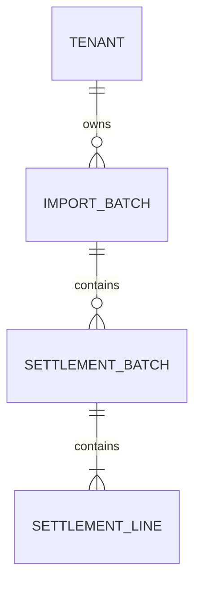

# ReconBridge

**Settlement Reconciliation & Exception Management**

ReconBridge is a Java backend portfolio project for comparing internal payments, processor settlements, and bank credits. It implements two-pass reconciliation domain logic, tenant-isolated import APIs, CSV upload and validation, and transactional settlement persistence.

**Current milestone:** settlement records and the import's `READY` transition can be persisted atomically. The parser and persistence service are tested components; the end-to-end worker that reads an uploaded file and invokes them is the next implementation step.

## Problem statement

A successful payment does not prove that the expected settlement reached the bank. Fees, missing records, duplicate references, delayed credits, currency differences, and incorrect amounts can produce discrepancies between systems.

ReconBridge compares payment evidence with processor settlement lines, then compares settlement batch totals with bank credits. Matching reports explain discrepancies and preserve ambiguous candidates. The planned investigation workflow will add controlled review, independent approval, and audit history.

### Example

| Item | Amount |
| --- | ---: |
| Successful payments | INR 3,000 |
| Processor fees | INR 60 |
| Expected bank credit | INR 2,940 |
| Actual bank credit | INR 2,900 |
| Shortfall to investigate | INR 40 |

## Implementation status

| Area | Current status |
| --- | --- |
| Monetary values and matching keys | Implemented and tested |
| Payment-to-settlement matching | Implemented and tested as domain logic |
| Settlement-to-bank matching and combined reports | Implemented and tested as domain logic |
| MySQL, Flyway, import lifecycle, and optimistic locking | Implemented and tested |
| Keycloak authentication and tenant-scoped import APIs | Implemented and tested |
| Metadata registration and actual CSV upload | Implemented and tested |
| Processor settlement CSV parser | Implemented and tested |
| Atomic settlement persistence and `READY` transition | Implemented; latest local build reported successful |
| Stored-file reading, hash re-verification, and processing coordinator | Next milestone |
| Reconciliation over selected persisted imports | Planned |
| Exception review, audit workflow, Kafka, and Kubernetes | Planned |

Uploading currently creates a `RECEIVED` import. It does not automatically parse the file, persist settlement rows, or run reconciliation. `rowCount` remains zero until processing completes successfully.

## Technology stack

| Technology | Current use |
| --- | --- |
| Java 21 | Records, collections, streams, monetary calculations, file I/O, SHA-256 |
| Spring Boot 4.1.1 / Spring MVC | REST APIs, multipart handling, application configuration |
| Spring Security OAuth2 Resource Server / Keycloak | JWT validation, realm-role mapping, tenant identity |
| Jakarta Bean Validation | API request validation |
| Spring Data JPA / Hibernate | Tenant and import mappings, optimistic version checks |
| Spring JDBC / JdbcTemplate | Prepared settlement inserts and JDBC batching |
| MySQL / Flyway | Relational integrity and versioned schema migrations |
| Apache Commons CSV 1.14.1 | Processor settlement CSV parsing |
| Spring Boot Actuator | Health endpoint |
| JUnit / AssertJ / Mockito / MockMvc | Unit and integration testing |
| Maven Wrapper / Git / Postman | Build, version control, and manual API verification |

Kafka, transactional outbox delivery, Docker/Testcontainers, and Kubernetes are roadmap items. Spring Batch remains a possible future option, not an implemented dependency.

## Implemented capabilities

### Reconciliation domain

- Immutable `Money` values use integer minor units, currency validation, and overflow-checked arithmetic.
- Tenant-aware and provider-aware `MatchKey` values identify payment matches.
- `SettlementKey` adds bank-account and settlement references for bank matching.
- Strategy-based matching reports `MATCHED`, `MISSING_COUNTERPART`, `AMBIGUOUS`, `AMOUNT_MISMATCH`, and `CURRENCY_MISMATCH`.
- Candidate indexes preserve repeated references instead of silently choosing one match.
- Settlement lines validate gross, fee, and net amounts; batches validate their declared total against line net amounts.
- Reports identify orphan settlement lines and orphan bank credits, with separate outcome counts for both passes.
- Bank comparisons include signed differences when currencies match.
- Combined reconciliation uses the same settlement evidence for both passes and requires both passes and orphan checks to succeed.
- Domain safeguards reject duplicate IDs, duplicate internal payment keys, and settlement-line reuse across supplied batches.

### Authentication, authorization, and tenant isolation

- Validates JWT issuer, timestamps, audience, and tenant claim.
- Uses an administrator-controlled `tenant_id` claim rather than caller-supplied tenant values.
- Explicitly maps `IMPORTER`, `ANALYST`, `APPROVER`, and `AUDITOR` realm roles.
- Uses stateless security and denies endpoints unless explicitly permitted.
- Returns the authenticated subject and tenant from `GET /api/me`.
- Looks up imports using both tenant ID and import ID; absent and foreign-tenant imports return `404`.
- Requires `IMPORTER` for registration and upload. An `AUDITOR`-only token can read permitted resources but cannot create imports.

### Registration and file upload

- Accepts JSON metadata registration or multipart CSV upload at `POST /api/imports`.
- Generates import IDs and initializes status `RECEIVED`, row count zero, and the initial persistence version.
- Returns `201 Created` with a `Location` header.
- Enforces uniqueness on `(tenant_id, source_type, source_system, file_hash)` through MySQL, including competing registrations.
- Returns `409` for duplicate content; separate tenants may register identical content independently.
- Multipart upload computes SHA-256 from actual streamed bytes, generates storage filenames, and stores opaque `local:<uuid>.csv` references.
- Enforces size and filename rules, removes partial writes where cleanup succeeds, and removes a newly stored duplicate while preserving the original.
- Rejects unprovisioned tenants and validates metadata fields.

JSON registration validates the supplied hash's format but does not verify file contents or fetch its supplied URI. Multipart upload generates the hash and storage reference on the server. A `.csv` extension alone does not establish that the file is valid CSV.

### Import lifecycle and concurrency

- Guarded transitions support `RECEIVED -> PROCESSING -> READY`, with `REJECTED` for invalid content and `FAILED` for operational failure.
- An explicit `FAILED -> PROCESSING` retry transition exists in the lifecycle service.
- `READY` and `REJECTED` are terminal in the current model.
- Application services enforce expected-version checks alongside JPA `@Version` optimistic locking.
- Service responses are immutable snapshots containing the persisted version.
- Integration tests verify that stale workers cannot overwrite committed state.

These lifecycle operations exist at the service layer. Automatic failure classification, retry orchestration, and an HTTP processing endpoint are not yet wired into upload.

### Processor settlement CSV validation

- Requires the documented header order and validates UTF-8, with optional byte-order mark support.
- Supports quoted CSV fields, including references containing commas.
- Validates canonical UUIDs, supported currency codes, integer minor-unit amounts, line arithmetic, and batch totals.
- Rejects duplicate settlement line IDs across the file and inconsistent batch metadata.
- Preserves repeated payment references so reconciliation can classify them as ambiguous.
- Derives tenant and provider from trusted import context; neither is accepted as a CSV column.
- Enforces a default maximum of 100,000 data records.
- Reports content errors as `CsvValidationException`; technical read failures remain `IOException`.


### Bank statement CSV parsing

Implemented a bank-credit CSV parser using Apache Commons CSV.

The parser:
- Receives tenant identity from trusted application code.
- Validates headers, UUIDs, required fields, positive minor-unit amounts,
  currency codes, and UTF-8 encoding.
- Rejects duplicate credit IDs within a file.
- Preserves distinct credits sharing a settlement key so reconciliation
  can detect ambiguous matches.
- Limits input to 10 MiB and 100,000 data records.
- Returns an immutable list of validated BankCredit objects.

Parser unit tests cover valid input, duplicate IDs, invalid values,
encoding, quoted fields, malformed CSV, and file-size validation.

Bank-credit database persistence and processing-endpoint integration
are the next implementation stages.

### Atomic settlement persistence

- Uses tenant- and import-scoped composite keys and foreign keys for settlement evidence.
- Validates tenant ownership, source type, provider, `PROCESSING` status, expected version, and supplied batch identities.
- Writes settlement rows using JDBC batches of up to 500 lines.
- Flushes the versioned import update before inserting evidence to protect competing completions.
- Commits batches, lines, row count, version, and the `READY` status together in one transaction.
- Rolls back all new records and import changes if persistence fails.
- Requires an existing transaction at the settlement write repository boundary.

The JDBC batch size does not split the transaction. The rollback integration test deliberately fails a later insert and verifies that earlier inserts and the JPA update are rolled back.

### Bank-credit persistence

Added a Flyway migration for tenant-scoped bank-credit storage.

BankCreditPersistenceService saves credits and transitions a BANK_STATEMENT
import from PROCESSING to READY in one transaction.

Completion validates tenant ownership, source type, lifecycle state,
expected version, and duplicate credit IDs.

The versioned import update is flushed before credit insertion.
A later persistence failure rolls back both the inserted credits and
the READY transition.

Distinct credits with the same settlement matching key are preserved
for ambiguity detection during reconciliation.

Integration tests cover successful completion, stale-version rejection,
tenant isolation, invalid inputs, and rollback after a later insert fails.

Bank statement processing is not yet connected to the HTTP endpoint.

### Settlement evidence API

Processed processor settlement imports expose paginated batch and line
read endpoints:

- GET /api/imports/{importId}/settlement-batches
- GET /api/imports/{importId}/settlement-batches/{batchId}/lines

Both endpoints derive tenant identity from the validated JWT and permit
IMPORTER, ANALYST, APPROVER, and AUDITOR roles.

Evidence is available only for PROCESSOR_SETTLEMENT imports in READY status.
Missing imports and imports belonging to another tenant return 404.

Pagination uses zero-based page numbers. The default page size is 20,
with an allowed range of 1–100. Responses include items, page, size,
totalElements, and totalPages.

Service unit tests cover pagination, ownership lookup, source and status
validation, missing batches, and empty pages. HTTP access and database
retrieval are verified separately through Postman.

## Design patterns and data structures

| Technique | Where it is used |
| --- | --- |
| Strategy | Interchangeable payment and bank matching contracts |
| Adapter | CSV input converted into validated domain records; storage abstraction |
| Repository | Tenant-scoped persistence and settlement writes |
| Application service / transaction boundary | Lifecycle operations and atomic settlement completion |
| Immutable records | Money, identities, matching results, and service snapshots |
| HashMap | Candidate indexing and settlement-key validation |
| HashSet | Duplicate IDs, reused lines, and orphan detection |
| LinkedHashMap | CSV batch grouping with input-order preservation |
| EnumMap | Outcome counts for reconciliation reports |

Matching and parser passes use expected linear-time indexing/grouping relative to their input sizes. The parser retains parsed records, so its memory use is O(n); upload streams bytes rather than loading the full file into memory.

## Available API endpoints

Base URL: `http://localhost:8083`

| Method | Endpoint | Request format | Access |
| --- | --- | --- | --- |
| GET | `/actuator/health` | No body | Public |
| GET | `/api/me` | No body | Any application role |
| GET | `/api/imports/{importId}` | No body | Any application role; own tenant only |
| POST | `/api/imports` | `application/json` | `IMPORTER` |
| POST | `/api/imports` | `multipart/form-data` | `IMPORTER` |
| POST | /api/imports/{importId}/process | Process an uploaded settlement import | IMPORTER |

Use the access token as `Authorization: Bearer <access-token>`. Obtain a fresh token when it expires. Never commit tokens, passwords, or client secrets.

### JSON metadata registration

```json
{
  "sourceType": "PROCESSOR_SETTLEMENT",
  "sourceSystem": "PROCESSOR_A",
  "fileName": "settlement.csv",
  "fileUri": "demo://imports/settlement.csv",
  "fileHash": "aaaaaaaaaaaaaaaaaaaaaaaaaaaaaaaaaaaaaaaaaaaaaaaaaaaaaaaaaaaaaaaa",
  "businessDate": "2026-10-21"
}
```

The hash and URI above are synthetic metadata examples.

### Multipart upload in Postman

Choose **Body -> form-data**:

| Key | Type | Example |
| --- | --- | --- |
| `file` | File | `samples/processor-settlement-valid.csv` |
| `sourceType` | Text | `PROCESSOR_SETTLEMENT` |
| `sourceSystem` | Text | `PROCESSOR_A` |
| `businessDate` | Text | `2026-10-21` |

Let Postman generate the multipart `Content-Type` and boundary. Remove a manually set `application/json` header. The response's `id` is the import ID used by subsequent GET requests and database checks.

### Response behavior

| Scenario | Status |
| --- | --- |
| Successful registration or upload | `201` |
| Successful own-tenant lookup | `200` |
| Invalid metadata, malformed import UUID, or invalid upload | `400` |
| Missing, expired, or invalid token | `401` |
| Insufficient role or unprovisioned tenant during registration | `403` |
| Missing or foreign-tenant import | `404` |
| Duplicate registered content | `409` |
| Upload exceeds configured limits | `413` |
| File storage failure | `500` |

Application error handlers use Problem Details with codes such as `DUPLICATE_IMPORT`, `IMPORT_NOT_FOUND`, and `VALIDATION_FAILED`. Security failures may have empty response bodies.

## Processor settlement CSV contract

```csv
batchId,settlementReference,bankAccountReference,declaredNetMinor,lineId,paymentReference,grossMinor,feeMinor,netMinor,currency
aaaaaaaa-aaaa-4aaa-8aaa-aaaaaaaaaaaa,SETTLEMENT-001,BANK-ACCOUNT-001,37100,11111111-1111-4111-8111-111111111111,PAY-001,12550,150,12400,INR
aaaaaaaa-aaaa-4aaa-8aaa-aaaaaaaaaaaa,SETTLEMENT-001,BANK-ACCOUNT-001,37100,22222222-2222-4222-8222-222222222222,PAY-002,25000,300,24700,INR
```

- Every row represents one settlement line.
- Repeat the batch ID, settlement reference, bank account reference, declared batch total, and currency for each line in that batch.
- `declaredNetMinor` is the whole batch total: `12,400 + 24,700 = 37,100` in this example.
- `lineId` must be unique across the file; `paymentReference` may repeat.
- The import's `sourceSystem` is the domain provider. Related internal payment records must use the same provider value for matching.
- Amounts use integer minor units, not decimal strings or floating-point values.
- The earlier three-column upload fixture is not a valid settlement-processing file.

## Persistence model



The diagram shows the intended complete batch structure; the foreign key alone does not enforce at least one child line.

| Table | Purpose and key constraints |
| --- | --- |
| `tenant` | Provisioned tenants |
| `import_batch` | Import source metadata, fingerprint, status, row count, and optimistic version |
| `settlement_batch` | Primary key `(tenant_id, import_id, batch_id)`; unique settlement key within an import |
| `settlement_line` | Primary key `(tenant_id, import_id, line_id)`; composite foreign key to its batch |

Migrations added:

- `V1__create_tenant_and_import_batch.sql`
- `V2__create_settlement_tables.sql` (or the next unused version if V2 was already allocated locally)

Payment references are indexed, not unique. Provider and currency live on the parent batch. Database checks validate each line's arithmetic; the domain model validates totals across lines. The same source IDs may exist in separate imports, so future reconciliation must select imports explicitly.

## Local configuration

### Prerequisites

- JDK 21 available to both IntelliJ and the Maven Wrapper.
- Local MySQL with application and test schemas and users provisioned.
- Standalone Keycloak for manual authenticated API testing.
- The `reconbridge` realm, configured client, application roles, tenant attribute mapper, and application users.

| Setting | Application | Tests |
| --- | --- | --- |
| Schema | `reconbridge` | `reconbridge_test` |
| MySQL user | `reconbridge_app` | `reconbridge_test_app` |
| Password environment variable | `RECONBRIDGE_DB_PASSWORD` | `RECONBRIDGE_TEST_DB_PASSWORD` |

MySQL must run before startup or integration tests. Flyway applies migrations automatically. Keep JPA schema management set to `validate`. Test configuration must also supply the security properties required to create the application context.

### Keycloak

| Property | Local value |
| --- | --- |
| Base URL | `http://localhost:8081` |
| Realm | `reconbridge` |
| `reconbridge.security.issuer` | `http://localhost:8081/realms/reconbridge` |
| `reconbridge.security.jwk-set-uri` | `http://localhost:8081/realms/reconbridge/protocol/openid-connect/certs` |
| `reconbridge.security.audience` | `reconbridge-api` |

Use the existing Postman OAuth authorization-code configuration with PKCE. Obtain importer and auditor tokens by signing in as their respective users. Token labels do not change identity or roles. An auditor must not inherit `IMPORTER` through a group or composite role.

### Storage settings

Merge these settings into the existing YAML sections:

```yaml
spring:
  servlet:
    multipart:
      max-file-size: 10MB
      max-request-size: 11MB

reconbridge:
  storage:
    root: ${RECONBRIDGE_STORAGE_ROOT:./var/imports}
    max-bytes: 10485760
```

The default storage directory is relative to the application's working directory. Use `RECONBRIDGE_STORAGE_ROOT` when a stable absolute location is needed. Keep `/var/` in `.gitignore`. Do not change the root while expecting existing `local:` references to resolve.

## PowerShell command reference

Run project commands from the repository root. Environment variables set in one PowerShell session are not automatically supplied to an already-running IntelliJ process; configure the IDE run configuration separately.

### Start Keycloak

From the installed Keycloak `bin` directory:

```powershell
.\kc.bat start-dev --http-port=8081
```

Starts the local development identity provider on port 8081. Keep it running while acquiring tokens and performing real authentication checks in Postman.

### Supply database passwords for the current session

```powershell
$appCredential = Get-Credential -UserName "reconbridge_app" -Message "Application database password"
$env:RECONBRIDGE_DB_PASSWORD = $appCredential.GetNetworkCredential().Password
Remove-Variable appCredential

$testCredential = Get-Credential -UserName "reconbridge_test_app" -Message "Test database password"
$env:RECONBRIDGE_TEST_DB_PASSWORD = $testCredential.GetNetworkCredential().Password
Remove-Variable testCredential
```

The prompts avoid placing literal passwords in command history or tracked configuration. Maven started from this session inherits these variables; they last for the session unless removed.

### Run the application

```powershell
.\mvnw.cmd spring-boot:run
```

Starts ReconBridge using the application configuration and applies pending migrations. Keep this terminal open, or run the application through IntelliJ with equivalent environment variables.

### Check application health

```powershell
Invoke-RestMethod -Uri "http://localhost:8083/actuator/health"
```

Checks the public health endpoint without a bearer token. A successful local startup should return `status: UP`; this alone does not verify business authorization.

### Run all tests

```powershell
.\mvnw.cmd clean test
```

Rebuilds the project and executes unit and integration tests. MySQL and the test database credentials are required for database-backed tests.

### Run focused tests

```powershell
.\mvnw.cmd "-Dtest=ImportRegistrationIntegrationTest" test
.\mvnw.cmd "-Dtest=ImportUploadIntegrationTest" test
.\mvnw.cmd "-Dtest=SettlementCsvParserTest" test
.\mvnw.cmd "-Dtest=SettlementPersistenceServiceIntegrationTest" test
```

Runs the selected feature's tests to isolate failures. Parser tests do not require MySQL or Keycloak; HTTP security integration tests mock JWT decoding rather than acquiring live tokens.

### Inspect a failed build

```powershell
Get-ChildItem ".\target\surefire-reports\*.txt" |
    Select-String -Pattern "Caused by:|SQL State|Error Code|Tests run:" -Context 0,2
```

Finds root-cause details and test summaries in Maven Surefire reports. Diagnose the original exception rather than treating a repeated application-context failure-threshold message as the cause.

### Verify a sample file's SHA-256 hash

```powershell
(Get-FileHash -LiteralPath ".\samples\processor-settlement-valid.csv" -Algorithm SHA256).Hash.ToLowerInvariant()
```

Calculates the hash of the actual sample bytes. Compare it with the uploaded import's `file_hash`; changing whitespace or line endings changes the hash.

### Inspect migrations and Git changes

```powershell
Get-ChildItem ".\src\main\resources\db\migration\mysql" | Select-Object Name

git status
git diff --stat
```

Lists migration versions before creating another migration, then summarizes local Git changes. Preserve applied migrations and stage only intended source, test, sample, and documentation files.

## Verification coverage

The latest local build was reported successful after adding transactional settlement persistence. With the supplied test classes unchanged, the expected suite contains **144 tests**; use the actual Maven summary as the authoritative count.

Coverage includes:

- Monetary calculations, matching decisions, ambiguity, orphan detection, and combined reports.
- Flyway migrations, persistence constraints, tenant isolation, and import lifecycle guards.
- Expected-version checks and overlapping-transaction optimistic locking scenarios.
- JWT claim validation and HTTP authorization.
- Duplicate registration, concurrent registration, and continued operation after rollback.
- Uploaded bytes, SHA-256 calculation, partial-file cleanup, and duplicate-file preservation.
- CSV structure, encoding, amounts, totals, identifiers, row limits, and technical read errors.
- Atomic settlement completion, foreign-tenant rejection, stale completion rejection, and rollback after a later insert fails.

Manual Postman checks covered identity, own-tenant retrieval, cross-tenant denial, missing authentication, registration, duplicate handling, actual upload, and auditor POST denial. MockMvc storage-limit tests do not establish the real servlet container's multipart size-limit behavior; verify that through an actual HTTP upload.

## Current limitations

- There is no processing HTTP endpoint or background worker connecting upload, file retrieval, hash re-verification, parsing, and persistence yet.
- Parsing returns in-memory domain batches; it is not automatically triggered by upload.
- Retry transitions exist, but automatic restart/recovery and abandoned `PROCESSING` detection are not implemented.
- Local files and MySQL commits are not atomic. Known failures trigger cleanup, but crashes, cleanup failures, or uncertain commit outcomes can leave files requiring recovery. Automated orphan cleanup is planned.
- Local storage is not a shared multi-instance deployment solution.
- Internal payment and bank statement parsers/persistence are not implemented yet, although their domain models and matching strategies exist.
- Exception investigation, independent approval, and audit workflow are planned features.
- No live bank integrations or payment initiation are implemented.

### End-to-end settlement import processing

- Added POST /api/imports/{importId}/process, restricted to IMPORTER.
- Verifies tenant ownership and server-recorded file ownership.
- Claims RECEIVED imports using the expected optimistic version.
- Reads the stored file and verifies its SHA-256 hash before parsing.
- Persists settlement batches and lines together with the READY transition.
- Marks invalid CSV as REJECTED and technical failures as FAILED when
  the failure transition can be committed.
- Prevents stale workers from overwriting newer import state.
- Includes integration tests for processing, authorization, integrity
  failures, competing requests, and transaction rollback.

Processing is currently synchronous. Automatic recovery of abandoned
PROCESSING imports, retry endpoints, and persisted error history remain planned.

## Next milestones

1. Connect tenant-scoped import claiming, stored-file reading, hash verification, parsing, and atomic persistence.
2. Classify invalid contents as `REJECTED` and technical failures as `FAILED`, while protecting against stale workers; expose a secured processing endpoint and test it.
3. Add persisted processing-error details, retry/recovery behavior, and orphan-file handling.
4. Add internal payment and bank statement ingestion and reconciliation over explicitly selected persisted imports.
5. Add exception investigation, independent approval, and audit history.
6. Introduce transactional outbox delivery and Kafka with failure-recovery tests.
7. Add reproducible container setup, Testcontainers, CI, observability, and a documented demo.
8. Add Kubernetes deployment and recovery exercises after the processing and storage model supports them.

## Project documentation

See [Project requirements and architecture](docs/ReconBridge_Project_Requirements_and_Architecture.docx) for design diagrams and a PowerShell command reference. The document includes planned architecture; the implementation status and boundaries above describe this checkpoint.

## Scope

ReconBridge is a learning and portfolio project using synthetic data. It does not initiate real payments or connect to live bank accounts. Monetary examples demonstrate reconciliation logic, not a production banking platform.
